<div align="center">




**An onboard AI health guardian for Moon & Mars crews.**
**It flags health risk ~48 hours early and tells the astronaut what to do, with no doctor on Earth required.**


</div>

---

<p align="center"></p>

## 📡 The Problem

On the way to Mars, a message to Earth takes **up to 22 minutes, one way**. If an astronaut's body starts to struggle, mission control cannot respond in real time.

NASA studies the stressors of spaceflight **one at a time**: radiation, sleep loss, isolation, cardiovascular strain. In a real body they hit **together**.

## 🚀 The Solution

**Orbit Mafia lives with the crew.** It watches radiation, sleep, heart, mood and blood inflammation **together**, rolls them into one explainable score, the **Crew Resilience Index (CRI)**, and warns the crew about **~48 hours before** the risk window.

Then an AI copilot explains **why** in plain language and suggests **NASA-documented countermeasures**, grounded only in a curated knowledge file.

> ⚠️ **Orbit Mafia never diagnoses.** It produces **risk flags and suggested countermeasures only.**

---

## ✨ Features

| | Screen | What it does |
|---|---|---|
| 🟢 | **Crew Board** | 4 astronauts, traffic-light status, CRI 0–100, sparkline |
| 📈 | **Astronaut Detail** | HR, HRV, sleep, radiation, exercise, mood trends (7 / 30 sol) plus NASA OSDR biomarkers |
| 🚨 | **Risk Alert + AI Copilot** | Why CRI dropped, predicted 48h window, suggested actions with sources |
| ⏯️ | **Mission Replay** | Play Sol 140 → 145 and watch the radiation spike and the prediction happen live |

---

## 🧮 The Crew Resilience Index (CRI)

One number from 0 to 100. One slide to explain. **No black box.**

```
        CRI  =  100  −  Σ ( weight × stress term × 100 )

   ┌──────────────┬────────┬────────────────────────────────────────┐
   │ Stress term  │ Weight │ Driven by                              │
   ├──────────────┼────────┼────────────────────────────────────────┤
   │ Radiation    │  0.30  │ daily mSv dose, solar particle events  │
   │ Sleep        │  0.25  │ hours slept vs. baseline opportunity   │
   │ Cardio       │  0.25  │ resting HR up, HRV down vs. baseline   │
   │ Mood         │  0.10  │ daily mood check-in (isolation stress) │
   │ Inflammation │  0.10  │ real OSDR biomarkers (CRP, etc.)       │
   └──────────────┴────────┴────────────────────────────────────────┘

        🟢 GREEN   high resilience      🟡 AMBER   watch closely      🔴 RED   high risk
```

> The exact normalisation ranges and status thresholds live in `backend/app/services/cri_constants.py` (formula version `v1`).

### 🔮 The 48-hour risk flag

The last 3 CRI values are extrapolated forward 2 sols. A flag is raised if the **predicted CRI drops below 60**, or if **2 or more vitals are anomalous on the same sol** (z-score against the crew member's own rolling baseline, with an Isolation Forest as a second opinion).

---

## 🏗️ Architecture

```
  ┌─────────────────────┐        ┌───────────────────────────────────────────┐
  │   NASA OSDR OSD-575 │        │           SYNTHETIC GENERATOR             │
  │  (real blood panels)│        │  HR · HRV · sleep · radiation · mood      │
  └──────────┬──────────┘        │  (seeded, always labelled SYNTHETIC)      │
             │                   └─────────────────────┬─────────────────────┘
             ▼                                         ▼
        ┌─────────────────────────────────────────────────────┐
        │              SQLite  (read-only for the API)        │
        └──────────────────────────┬──────────────────────────┘
                                   ▼
   ┌───────────────────────────────────────────────────────────────────────┐
   │                        FastAPI  ·  /api/v1                            │
   │                                                                       │
   │   CRI Engine ──► Anomaly + Risk Flag ──► Scenario Engine (Sol 140-145)│
   │                                 │                                     │
   │                                 ▼                                     │
   │   AI Copilot ◄── Knowledge file (NASA HRP countermeasures)            │
   │       │                                                               │
   │       ├─ live   : Groq LLM (output safety-filtered)                   │
   │       ├─ cached : pre-computed responses (works offline)              │
   │       └─ template: deterministic fallback                             │
   └──────────────────────────────┬────────────────────────────────────────┘
                                  │  JSON (Zod-validated)
                                  ▼
   ┌───────────────────────────────────────────────────────────────────────┐
   │        React + Vite + TypeScript  ·  Tailwind  ·  Recharts            │
   │   Crew Board  ·  Astronaut Detail  ·  Alerts + Copilot  ·  Replay     │
   └───────────────────────────────────────────────────────────────────────┘
```

---

## 🛰️ Real vs. Synthetic Data

Judges, please read this one. We label everything.

| Data | Source | Label in app |
|---|---|---|
| Blood biomarkers (CRP, fibrinogen, cytokines, CMP) | **NASA OSDR OSD-575 / LSDS-8**, real crew, 7 timepoints | `REAL_OSDR` |
| Heart rate, HRV, sleep, radiation, exercise, mood | **Generated by us** (seed `42`) | `SYNTHETIC` |

Why synthetic? The public OSDR dataset contains blood panels, **not** daily sleep, HR, HRV or radiation streams. We generate those, we say so, and the provenance badge appears on every data card. The `/provenance` endpoint discloses it all.

The demo **replays** real OSDR biomarker timepoints against a synthetic Mars-transit timeline for illustration. It is not a real astronaut record.

---

## 🧰 Tech Stack

| Layer | Tools |
|---|---|
| **Backend** | Python · FastAPI · Pydantic v2 · SlowAPI · SQLite |
| **ML** | NumPy · pandas · scikit-learn (Isolation Forest + z-score baseline) |
| **LLM** | Groq (OpenAI-compatible API) with cached + templated fallbacks |
| **Frontend** | React 18 · Vite · TypeScript · Tailwind · TanStack Query · Recharts · Zod |
| **Quality** | pytest · vitest · bandit · pip-audit · gitleaks · pre-commit |

---

## 🔌 API at a Glance

Base URL: `/api/v1`

| Method | Endpoint | Purpose |
|---|---|---|
| `GET` | `/health` | Liveness check |
| `GET` | `/crew` | CRI summary for all crew |
| `GET` | `/crew/{id}/vitals` | Vitals time series (`window` 7 or 30) |
| `GET` | `/crew/{id}/cri` | CRI plus per-term contributions |
| `GET` | `/crew/{id}/biomarkers` | Real OSDR biomarkers |
| `GET` | `/scenario/state?sol=140..145` | Mission replay snapshot |
| `POST` | `/copilot/explain` | AI explanation and countermeasures (`{crewId, sol}` only) |
| `GET` | `/provenance` | Data sources and synthetic-field disclosure |

Full spec: [`docs/API_CONTRACT.md`](docs/API_CONTRACT.md)

---

## 🔐 Security by Design

```
   ╔═══════════════════════════════════════════════════╗
   ║  SHIELDS UP                                       ║
   ╠═══════════════════════════════════════════════════╣
   ║  ▸ No free text reaches the LLM (prompt injection ║
   ║    removed by design: copilot takes {crewId, sol})║
   ║  ▸ LLM output is safety-filtered; sources must    ║
   ║    come from the provided knowledge snippets      ║
   ║  ▸ Strict schemas: unknown fields rejected (422)  ║
   ║  ▸ Read-only DB connection for API routes         ║
   ║  ▸ Rate limits per IP, 1 KB request body cap      ║
   ║  ▸ CORS allowlist; wildcard refused in prod       ║
   ║  ▸ Hardened security headers, no stack traces     ║
   ║  ▸ Secrets only in .env; gitleaks + pre-commit    ║
   ╚═══════════════════════════════════════════════════╝
```

Details: [`docs/SECURITY.md`](docs/SECURITY.md)

---

## 🧑‍🚀 Quick Start

### 1. Launch the backend

```bash
cd backend
python -m venv .venv && source .venv/bin/activate      # Windows: .venv\Scripts\activate
pip install -r requirements.txt
cp .env.example .env                                   # add GROQ_API_KEY for live copilot (optional)
uvicorn app.main:app --reload --port 8000
```

Check it: <http://localhost:8000/api/v1/health> · API docs (dev only): <http://localhost:8000/docs>

> No Groq key? No problem. The copilot falls back to cached and templated responses, so the demo works offline.

### 2. Launch the frontend

```bash
cd frontend
npm install
cp .env.example .env        # VITE_API_BASE_URL=http://localhost:8000/api/v1
npm run dev                 # http://localhost:5173
```

Set `VITE_USE_MOCK=true` to run the UI from bundled mock JSON with no backend.

### 3. Run the tests and the evaluation

```bash
cd backend && pytest
python scripts/eval_anomaly.py        # lead time + false-positive rate, ON SYNTHETIC DATA
```

---

## 📁 Project Structure

```
orbit-mafia/
├── backend/
│   ├── app/
│   │   ├── routers/        crew · scenario · copilot · provenance
│   │   ├── services/       cri_engine · anomaly · copilot_service · knowledge · scenario_engine
│   │   ├── security/       headers · rate limit · validators
│   │   ├── models/         strict Pydantic schemas
│   │   └── db/             read-only SQLite access
│   ├── knowledge/          NASA HRP countermeasures + cached copilot responses
│   ├── scripts/            synthetic generator · OSDR ingest · evaluation · cache precompute
│   └── tests/
├── frontend/
│   └── src/                pages · api client + Zod schemas · hooks · mocks
├── data/                   OSD-575 notes, raw (read-only), processed
└── docs/                   PRD · TRD · SECURITY · API_CONTRACT · design
```

---

## 📊 Evaluation

Measured by `backend/scripts/eval_anomaly.py`. **All figures are on synthetic crew telemetry**, not real astronaut data.

| Metric | Result |
|---|---|
| Early-warning lead time (C002) | _fill in from final eval run_ |
| False-positive rate on healthy crew | _fill in from final eval run_ |

---

## 🌌 What's Next

```
   [■■■■■■■■□□]  Wearable-style real sensor ingestion (replace synthetic streams)
   [■■■■■□□□□□]  Per-astronaut personal baselines over the full mission
   [■■■□□□□□□□]  Fully on-device LLM for true offline operation
   [■■□□□□□□□□]  Validation against more NASA / analog-mission datasets
   [■□□□□□□□□□]  Habitat-level view (shared air, light and workload)
```

---

## ⚖️ Disclaimer

Orbit Mafia is a hackathon prototype. It **does not diagnose, detect, or treat any disease** and is not a medical device. It offers risk flags and suggested countermeasures drawn from a curated reference file, intended to be reviewed by a flight surgeon when contact is possible. Synthetic data is always labelled as synthetic.

## 🙏 Acknowledgements

- **NASA Open Science Data Repository (OSDR)**, dataset OSD-575 / LSDS-8
- **NASA Human Research Program**, countermeasures evidence
- **NASA Space Apps Challenge 2026**, *The Next Frontier*

---

<div align="center">

### 👩‍🚀 Team Orbit Mafia

| Role | Name |
|---|---|
| Frontend | Hijab |
| Full-stack | Eman Fatima |
| Backend / Data | Hadi |
| Backend / AI | Javeria |

```
        .  *   .      "Ad astra per aspera"      .   *  .
          ✦        Through hardships to the stars        ✦
```

**Built for NASA Space Apps Challenge 2026** 🚀

</div>
